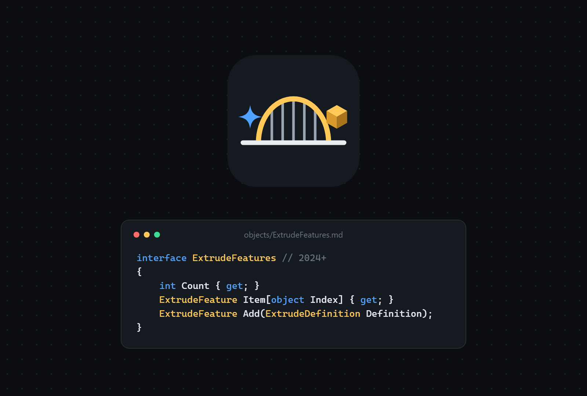

<p align="center">
  
</p>

<h1 align="center">InventorBridge</h1>

<p align="center">Help AI agents work with Autodesk Inventor.</p>

<p align="center">
  <a href="LICENSE"></a>
</p>

<p align="center">
  
</p>

A bridge between AI agents (Claude Code, Codex and other MCP clients) and Autodesk Inventor: API documentation designed for agents and an MCP server that lets an agent drive the Inventor you have open.

> Independent project, not affiliated with Autodesk. Autodesk and Inventor are registered trademarks of Autodesk, Inc.

## What exists today

- **[API reference](docs/reference/index.md)** for Inventor 2024 to 2027, generated from the interop DLLs:
  - one page per object and per enum, with the interface in pseudo-C#;
  - COM inheritance ("`ExtrudeFeature` inherits from `PartFeature`"), which the interop does not show;
  - an example path from `Application` to each object;
  - what returns each object and where each enum is used;
  - a `// since 20xx` mark on members that do not exist in every version;
  - [`members.tsv`](docs/reference/members.tsv), one member per line, for `grep`.
- **The reference generator** (`src/InventorBridge.ReferenceGenerator`).
- **MCP server** (`src/InventorBridge.Mcp`, first version): connects Claude Code, Codex or any MCP client to the Inventor running on your computer. The agent writes C# against the Inventor API, the server runs it inside Inventor, and you watch the result in your own Inventor window. The agent looks up the API with `api_lookup` instead of guessing names.

The full plan is in [ARCHITECTURE.md](ARCHITECTURE.md).

## Using it with Claude Code

Requirements: Windows, Autodesk Inventor 2024 or later, and the [.NET 8 SDK](https://dotnet.microsoft.com/download/dotnet/8.0).

1. Clone the repository and build the server. It references `Autodesk.Inventor.Interop.dll` from the Inventor 2024 installation (or from `lib/inventor/2024/`, see below):

   ```bash
   dotnet build src/InventorBridge.Mcp -c Release
   ```

2. Register it in Claude Code for every folder (adjust the path to where you cloned it):

   ```bash
   claude mcp add inventor --scope user -- C:\path\to\InventorBridge\src\InventorBridge.Mcp\bin\Release\net8.0-windows\InventorBridge.Mcp.exe
   ```

3. Open Inventor, open Claude Code and ask, for example: *"create a new assembly with two tubes and a 90° bend, and connect the three"*.

| Tool | What it does |
|---|---|
| `inventor_status` | Connects to the Inventor you have open: version, active project and workspace folder, default templates, open documents |
| `inventor_start` | Starts Inventor (visible) when it is not running, and waits until it is ready |
| `run_csharp` | Compiles and runs a C# script against the Inventor API. It runs as one undo step on the active document and is rolled back on an error; compilation errors come back with line and column |
| `inspect` | Structured summary of the active document: features and parameters of a part, occurrences, constraints and free degrees of freedom of an assembly, sheets of a drawing |
| `screenshot` | An image of the Inventor view, so the agent sees what you see |
| `api_lookup` | Looks up the API reference: an object's or enum's page, some members of a type, or a search by name. It hides members that the running Inventor version does not have, and works without Inventor |

Inventor must stay open while the agent works: the server talks to it through COM, out of process, so nothing is installed inside Inventor.

## Generating the reference

The Autodesk interop DLLs are not in the repository. Put one per version at `lib/inventor/<year>/Autodesk.Inventor.Interop.dll`:

| Version | Where to get it |
|---|---|
| 2024 and earlier | The Inventor installation: `C:\Program Files\Autodesk\Inventor <year>\Bin\Public Assemblies\` |
| 2025 and later | The interop downloads page on Autodesk support ("Inventor Interop binary files") |

Then, from the repository root (requires the .NET 8 SDK):

```bash
dotnet run --project src/InventorBridge.ReferenceGenerator
```

The generator does not run Inventor and does not need it installed: it only reads the DLLs' metadata. Building `InventorBridge.Mcp` copies the generated pages next to the server, for `api_lookup`.

## Layout

```
src/InventorBridge.Mcp/
  Connection/  COM connection: STA thread, retry of busy calls, attaching to or starting Inventor
  Scripting/   compiling and running run_csharp scripts (Roslyn), transactions
  Reading/     inventor_status, inspect and screenshot
  Reference/   api_lookup: searching the generated reference
  Tools/       the MCP tools
src/InventorBridge.ReferenceGenerator/
  Reading/     reading the DLLs and inheritance.txt
  Model/       per-version model and combined model
  Analysis/    version merging, inheritance, reverse indexes, access paths
  Output/      Markdown pages, index, members.tsv and JSON
  inheritance.txt   derived/base pairs extracted from the object model poster legend
docs/reference/     generated output (do not edit by hand)
assets/             logo and social preview (SVG sources and PNG)
docs/cover.svg      README and portfolio image (rendered to docs/cover.png)
```

## License

[MIT](LICENSE). The license covers the code and documentation in this repository, not the DLLs or any other Autodesk material, which remain under Autodesk's own terms.
